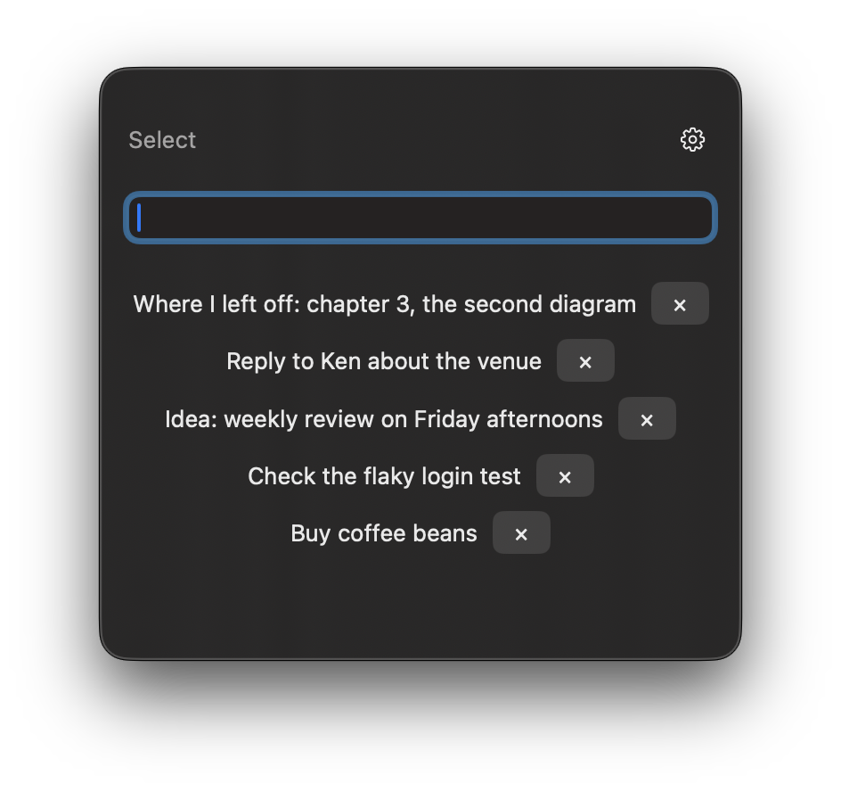

# Cue

Queue it now. Cue it later.



Cue is a lightweight buffer for thoughts you don't want to keep in your head.

It is not a task manager.
It stores short cues that help you resume interrupted thoughts quickly.

⌘⌘ popup
Enter
⌘⌘ close

## Requirements

- macOS 14 or later, Apple silicon or Intel
- Developed and tested on macOS 26. Earlier versions are supported by the build settings but have not been tested on real hardware.

## Install

1. Download `Cue-<version>.zip` from [Releases](https://github.com/tkys2019/Cue/releases).
2. Unzip it and move `Cue.app` to your Applications folder.
3. Open Cue.

Cue is free and is **not signed with an Apple Developer ID or notarized by Apple**, so macOS blocks it the first time. macOS says it cannot verify that Cue is free of malware.

1. Click **Done**. Do not click **Move to Trash**.
2. Open **System Settings > Privacy & Security**.
3. Scroll down to the message about Cue and click **Open Anyway**, then confirm.

If there is no **Open Anyway** button, or macOS says Cue is damaged, remove the download flag in Terminal and open Cue again:

```sh
xattr -dr com.apple.quarantine /Applications/Cue.app
```

This only removes the "downloaded from the internet" flag from Cue. Only do this if you downloaded Cue from this repository.

You can check the download against the SHA-256 shown on the release page:

```sh
shasum -a 256 Cue-<version>.zip
```

## First launch

- **Launch at login**: Cue asks once whether to start at login. You can change this later in **System Settings > General > Login Items**.
- **Accessibility**: the ⌘⌘ shortcut needs permission. Enable Cue in **System Settings > Privacy & Security > Accessibility**.
  Because Cue is not signed with a Developer ID, you may need to remove Cue from this list and enable it again after each update.
- **Reminders** (optional): macOS asks for access the first time you send a Cue to Reminders.

## Usage

- ⌘⌘ (tap ⌘ twice): show or hide Cue. Opening the app again also shows it.
- Type and press Enter to save a Cue.
- Click a Cue to copy it. Right-click it to send it to Reminders. × deletes it.
- **Select** lets you copy several Cues or send them to Reminders at once.
- The gear menu has the appearance settings, the hover effect, and **Quit Cue**.

## Privacy

- Cue has no network access. It runs in the macOS App Sandbox without the network permission.
- Your Cues are stored only on your Mac.
- Cue watches keyboard events only to detect the ⌘⌘ shortcut. It does not record or send what you type.
- Cue accesses Reminders only when you send a Cue there.

## Uninstall

1. Gear menu > **Quit Cue**.
2. Turn Cue off in **System Settings > General > Login Items**, and remove it from **Privacy & Security > Accessibility**.
3. Delete `Cue.app`.
4. To delete your Cues and settings, delete `~/Library/Containers/io.github.tkys2019.cue`.

## License

[MIT](LICENSE). Cue is provided "as is", without warranty of any kind.
